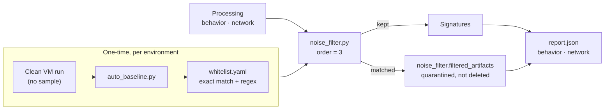

# CAPE Intelligent Noise Filter

**Strip routine Windows noise from CAPE sandbox reports without losing a single piece of evidence.**

A processing module for [CAPE v2](https://github.com/kevoreilly/CAPEv2) that removes normal OS background activity (telemetry, language packs, default service calls, virtualization artifacts) from `report.json` before signatures and reporting run, and quarantines everything it removes instead of deleting it.

## Why

A CAPE report contains far more than the sample's behavior. Thousands of registry reads, file touches and DNS lookups come from Windows itself, and analysts spend triage time scrolling past them to find real IOCs. Downstream, the same noise flows into SIEM, MISP or SOAR as false indicators.

Many CAPE signatures carry their own small allowlists, but those only suppress *alerts*. The underlying `behavior` and `network` data still holds the noise, and the exceptions are scattered across individual signatures. This module cleans the data itself, once, centrally:

- **Cleaner input everywhere.** Signatures, reports and every integration receive the same filtered data.
- **One policy.** All exceptions live in a single `whitelist.yaml` instead of hard-coded per signature.
- **Less work downstream.** Signatures evaluate a smaller dataset.

## How it works



The filter runs in CAPE's processing stage right after behavior parsing (`behavior.py` at order 2, `noise_filter.py` at order 3) and before signatures. It checks 11 artifact types against the whitelist:

| Behavior | Network |
|---|---|
| `read_keys`, `write_keys`, `delete_keys` | `domains` |
| `read_files`, `write_files`, `delete_files` | `hosts` |
| `mutexes`, `executed_commands` | `http` |

Rules use fast exact matching first and regex second. Anything that matches moves to `noise_filter.filtered_artifacts` in the same report, so a false positive can always be recovered and audited.

## Features

- **11-indicator filtering** across registry, files, mutexes, commands, DNS, IPs and HTTP.
- **Safe filtering.** Removed items are quarantined inside `report.json`, never discarded.
- **Automatic baselines.** One command learns thousands of normal behaviors from a clean VM run, tailored to each environment.
- **YAML-first rules.** Tune exact matches and regex without touching code.
- **Before/after stats.** `show_stats.py` reports how many artifacts were kept versus filtered for any analysis.

## Installation

Copy the files into a CAPE v2 host (default `/opt/CAPEv2`):

```bash
sudo cp noise_filter.py whitelist.yaml /opt/CAPEv2/modules/processing/
sudo cp auto_baseline.py /opt/CAPEv2/utils/

sudo chown cape:cape /opt/CAPEv2/modules/processing/{noise_filter.py,whitelist.yaml} /opt/CAPEv2/utils/auto_baseline.py
sudo chmod +x /opt/CAPEv2/utils/auto_baseline.py
```

Enable the module at the end of `/opt/CAPEv2/conf/processing.conf`:

```ini
[noise_filter]
enabled = yes
```

Restart the processor:

```bash
sudo systemctl restart cape-processor.service
```

## Usage

### 1. Build a baseline

Normal Windows behavior differs between environments, so start with your own baseline. Run a 5-minute analysis with **no sample** (a clean run), note its task ID, then:

```bash
cd /opt/CAPEv2
sudo -u cape python3 utils/auto_baseline.py <TASK_ID>
```

Thousands of normal behaviors are added to `whitelist.yaml`.

### 2. Tune rules

Add exact matches or regex by hand as needed:

```yaml
network_domains:
  regex:
    - ".*\\.windowsupdate\\.com"
    - ".*\\.mycompany\\.internal"
```

### 3. Review what was filtered

Every report carries a `noise_filter` block:

```json
"noise_filter": {
  "status": "success",
  "filtered_items_count": 5214,
  "filtered_artifacts": {
    "behavior": { "read_keys": ["..."] },
    "network": { "domains": ["..."] }
  }
}
```

### 4. Check the numbers

```bash
python3 show_stats.py /opt/CAPEv2/storage/analyses/<TASK_ID>/reports/report.json
```

Compares the kept data in `behavior.summary` with `noise_filter.filtered_artifacts` and prints both counts per category.

---

More projects at [hhkb.dev](https://hhkb.dev) · [Intbox](https://intbox.org)
